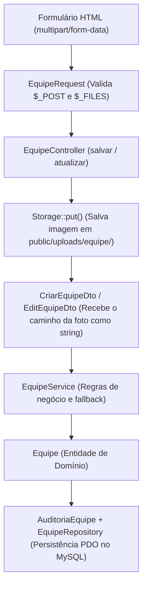

# Explicação Técnica: Problemas Encontrados e a Arquitetura DTO

Este documento detalha os problemas identificados no módulo **Equipe**, a relação direta desses erros com o padrão **DTO (Data Transfer Object)** e com a arquitetura em camadas do projeto, e como as soluções foram aplicadas com o menor impacto possível no código.

---

## 1. O que é um DTO e seu Papel na Arquitetura

O **DTO (Data Transfer Object)** é um padrão de projeto corporativo cujo único propósito é **transportar dados entre camadas** (por exemplo, da camada de apresentação/Controller para a camada de aplicação/Service).

### Características fundamentais de um bom DTO:
1. **Objeto anêmico (sem comportamento de negócio):** Ele contém apenas propriedades fortemente tipadas e, no máximo, um método fábrica (`fromArray`).
2. **Isolamento de camadas:** Ele protege o domínio/serviço contra mudanças e particularidades do transporte HTTP (`$_POST`, `$_FILES`, headers, etc.).
3. **Tipagem estrita e imutabilidade:** Propriedades `readonly` garantem que os dados não sofram mutações inesperadas durante o fluxo.

---

## 2. Diagnóstico dos Problemas Encontrados

Ao implementar o módulo `Equipe`, diversos erros em cadeia impediam o cadastro, edição e listagem. Os principais estavam diretamente ligados à fronteira do DTO:

### Problema A: Incompatibilidade de Tipos no Upload (`$_FILES` vs `string`)
* **O que ocorria:** 
  O formulário HTML enviava um arquivo (`<input type="file" name="foto">`). O `Core\Request` do framework mescla `$_POST` com `$_FILES`. Portanto, ao validar a foto, `$validated['foto']` continha um array nativo do PHP:
  ```php
  [
      'name' => 'avatar.png',
      'type' => 'image/png',
      'tmp_name' => 'C:\Windows\Temp\php...',
      'error' => 0,
      'size' => 45120
  ]
  ```
  Em seguida, o Controller chamava diretamente:
  ```php
  $dto = CriarEquipeDto::fromArray($validated);
  ```
  Como o construtor de `CriarEquipeDto` exigia `public readonly ?string $foto`, o PHP 8.1+ com `declare(strict_types=1)` disparava imediatamente um erro fatal:
  > **TypeError:** `Argument #3 ($foto) must be of type ?string, array given`

* **Por que isso é um problema de arquitetura DTO?**
  Um DTO não deve carregar detalhes de baixo nível do protocolo HTTP (como arrays de arquivos temporários do servidor com `tmp_name`), a menos que seja um DTO explicitamente desenhado para isso. No banco de dados (`tb_equipe`), a coluna `foto` é uma `VARCHAR(255)` que armazena a **URL ou caminho relativo do arquivo salvo**, e não os bytes ou o array temporário.

---

### Problema B: Rigidez no DTO de Edição (`EditEquipeDto`)
* **O que ocorria:**
  Em `EditEquipeDto`, a propriedade estava tipada como `public readonly string $foto` (não aceitava `null`), e o método `fromArray` fazia `$data['foto']` diretamente.
* **Impacto:**
  Ao editar um registro existente sem trocar a foto, o campo vinha nulo ou vazio, gerando:
  > **TypeError:** `Cannot assign null to property Src\App\Dto\Equipe\EditEquipeDto::$foto of type string`
  O usuário ficava impossibilitado de atualizar apenas o nome ou cargo sem ter que enviar a foto novamente.

---

### Problema C: O Ciclo de Vida do Upload (Onde salvar o arquivo?)
* **O que ocorria:**
  O arquivo temporário em `$_FILES['foto']['tmp_name']` é descartado pelo PHP assim que a requisição termina. Nenhum componente estava chamando o utilitário de persistência (`Storage::put`) para mover o arquivo para a pasta pública acessível pelo navegador.
* **Solução arquitetural:**
  Antes de transferir os dados para a camada de serviço através do DTO, o Controller (camada HTTP) utiliza a classe utilitária do sistema `Src\Core\Storage` para persistir o upload em `public/uploads/equipe/`. O retorno é uma string limpa (ex: `uploads/equipe/a1b2c3d4.webp`). Essa string é então injetada no DTO.

---

### Problema D: Regras de Validação no `EquipeRequest`
* **O que ocorria:**
  A regra de validação estava fixa como:
  ```php
  'foto' => ['required', 'fileType:jpg,png,jpeg,webp', 'fileSize:2048']
  ```
  Na edição, a foto não deve ser obrigatória se o membro já possui uma cadastrada.
* **Solução:**
  Condicionamos a regra com base na presença do `id`:
  - Se `id` for nulo/vazio (criação): `required`.
  - Se `id` estiver preenchido (edição): `nullable`.

---

### Problema E: Falhas de Persistência no Repositório
* **Em `EquipeRepository::getAll()`:** A query SQL era `SELECT id, nome, cargo, status, version FROM tb_equipe`. Faltava a coluna `foto`. Quando a linha `foto: $row['foto']` era executada, gerava o erro:
  > `Undefined array key "foto"`
* **Em `EquipeRepository::update()`:** A query SQL de atualização omitia `foto = :foto`. Assim, mesmo que o usuário enviasse uma foto nova, ela nunca era gravada no banco.

---

### Problema F: Views e Auditoria Incompatíveis (Resquícios de Cópia)
Ao duplicar o módulo base `Exemplo`, as views `editar.php`, `index.php` e a classe `AuditoriaEquipe.php` mantiveram chamadas a métodos inexistentes na entidade `Equipe`:
- Chamavam `$item->getTitulo()` e `$item->getDescricao()`, provocando:
  > **Fatal error:** `Call to undefined method Src\App\Models\Equipe::getTitulo()`
- A view de edição não possuía o atributo `enctype="multipart/form-data"`.

---

## 3. Resumo das Alterações Realizadas (Mínimo Possível)

| Arquivo | O que foi alterado | Motivo |
|---|---|---|
| `CriarEquipeDto.php` | Proteção em `fromArray`: `is_string($data['foto'] ?? null) ? $data['foto'] : null` | Evita quebra de tipo se um array for acidentalmente passado |
| `EditEquipeDto.php` | Propriedade alterada para `?string $foto` e valor padrão `null` | Permite editar um integrante mantendo a foto atual |
| `EquipeRequest.php` | Regra de foto dinâmica (`required` no cadastro, `nullable` na edição) | Permite atualizar dados sem re-enviar a foto |
| `EquipeController.php` | Chamada ao `Storage::put()` antes de montar o DTO; limpeza de `var_dump` | Converte o arquivo HTTP temporário em caminho string persistido |
| `EquipeService.php` | Fallback para foto existente (`$dto->foto ?? $existente->getFoto()`) e remoção de arquivo antigo | Mantém integridade do arquivo em disco |
| `EquipeRepository.php` | Adicionado campo `foto` no `SELECT` do `getAll()` e no `UPDATE`; remoção de `var_dump` | Corrige erro de array key e salva fotos atualizadas |
| `AuditoriaEquipe.php` | Substituído `getTitulo()`/`getDescricao()` por `getNome()`, `getCargo()`, `getFoto()` | Evita erro fatal durante o registro de auditoria |
| `views/Equipe/editar.php` | Adicionado `enctype="multipart/form-data"`, campos de foto/nome/cargo e preview da foto atual | Corrige campos inexistentes e permite upload no formulário |
| `views/Equipe/index.php` | Tabela ajustada para exibir Foto (avatar), Nome, Cargo e Ações | Corrige chamadas de métodos e exibe a listagem correta |
| `database/base.sql` | Removido `DROP TABLE tb_equipe;` residual | Impede que a tabela seja deletada acidentalmente no script |

---

## 4. Fluxo Correto dos Dados (Arquitetura Completa)



